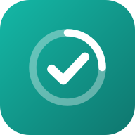

  

<h1 align="center">Day to Day</h1>

<b>Your day, your meals, your money — one simple app on your phone.</b>

---

Day to Day helps you keep a steady routine without needing a perfect one.
Plan your day, tick off what you did, follow your meal plan, keep an eye on
spending, never miss an EMI, and ask a friendly AI coach whenever you're stuck.

It's built for real, busy days: a "good day" is one where you did *most* of
your habits, not all of them. Miss something? Do a smaller version and keep the
streak going.

## What you can do

### Plan and track your day
- See your **daily timetable**, with the part you're in *right now* highlighted
  and how much time is left.
- Tick off your **daily checklist** (sleep, study, food, work, exercise,
  recovery, or whatever you choose). Sunday gets its own lighter list.
- Build a **streak** of good days and see your progress on a **4-week
  calendar**.
- Fill in a short **weekly log** (weight, waist, training, study, how you feel)
  and watch the trend.

### Follow your meal plan
- See **today's meals** item by item, with amounts, at the right times.
- Foods that give **protein** or **calcium** are labelled, so you know you're
  getting enough.
- Keep your **weekly shopping list** with expected prices and a budget.
- Notes on portions, what to add when you're still hungry, and health tips.

### Stay on top of money
- **Log every expense** in seconds: groceries, eating out, tea and snacks,
  travel, or your own categories like Rent or Bills.
- Set a **weekly food budget** and see what's left, plus a **safe amount to
  spend per day**.
- Compare **this week with last week** to see where the money goes.
- Track **loans and EMIs**: due dates, how many are paid, how much is left.
  Tap *Mark paid* and it's added to your spending automatically.
- Track **money owed**: who owes you and whom you owe, with due dates and
  part-payments.

### Get reminders
Tap the **bell** to see everything that needs you:
- EMIs and payments coming up, due today or overdue
- Going over your food budget
- Your own reminders (study time, gym, bedtime…)
- Meal times, with what's on the menu
- An evening nudge if your checklist isn't done yet

Turn on **phone notifications** to get them as pop-ups.

### Ask Buddy, your AI coach
Chat with Buddy about anything: "I skipped breakfast, what now?", "How do I
spend less this week?", "Explain today's meals", "Which EMI should I pay
first?". Buddy knows your plan and what you've logged, so the answers are about
*you*, not generic advice.

### Make it yours
Everything is editable in **Settings** (the gear icon): your name, timetable,
checklist, meals and menu, shopping prices, health notes, reminders and budget.
New users start with a simple example plan they can change.

## Install it on your phone

**Android (Chrome):** open the app link → tap **Install** on the Today screen
(or Chrome menu ⋮ → *Install app*).

**iPhone (Safari):** open the app link → tap **Share** → **Add to Home Screen**.

It then opens full-screen like a normal app, works **offline** (Buddy needs
internet), and has shortcuts. Long-press the icon for *Add spending*, *Ask
Buddy* and *Today's meals*.

## Your data and privacy

- Your plan and everything you log are **saved automatically on your own
  phone**, in the app's storage. Nothing to set up, no account needed.
- Your personal data is **not stored on any server**. The only thing sent out
  is what Buddy needs to answer a question you ask.
- The app is protected by a **password**.

### Keep a backup
Because your data lives on your phone, keep a copy somewhere safe:

1. Go to **Settings → Data & backup → Download full backup**.
2. Save the file to Google Drive or email it to yourself.
3. To restore, on a new phone or after clearing data, use **Import backup**.

The app reminds you to back up every 7 days.

> **Good to know:** clearing your browser's *cache* is safe. Clearing
> *cookies & site data* (or uninstalling the browser) deletes your data, which
> is what the backup is for. On iPhone, use the installed app icon, not a
> Safari tab, so your data stays put.

## Quick tips

- A day counts as **kept** when you finish most of your checklist. Aim for
  consistency, not perfection.
- On a hard day, **shrink the habit, don't skip it**.
- Tap **Ask Buddy** buttons on the Meals and Money screens to get help with
  exactly what you're looking at.

---

**Setting up or hosting the app yourself?** See the
[developer guide](DEVELOPMENT.md).
